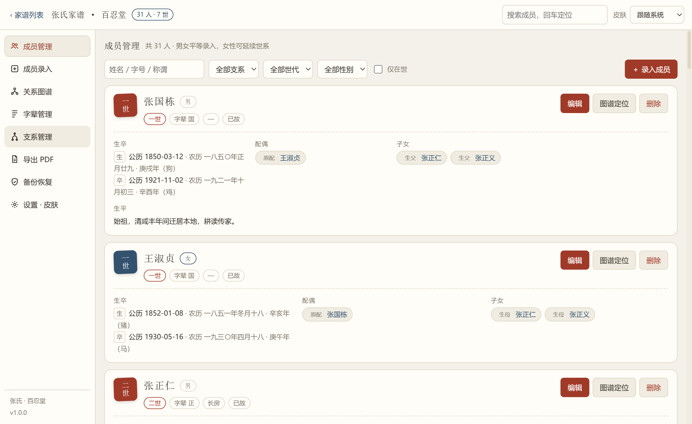
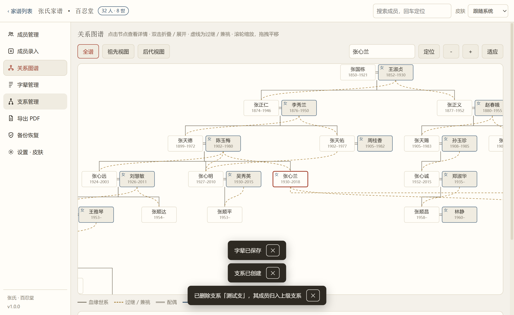
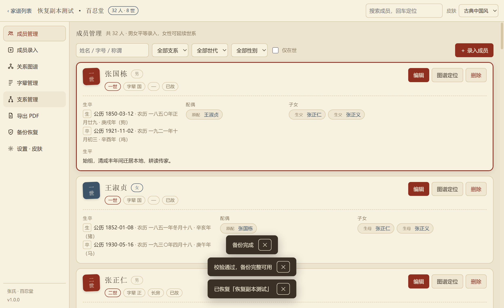
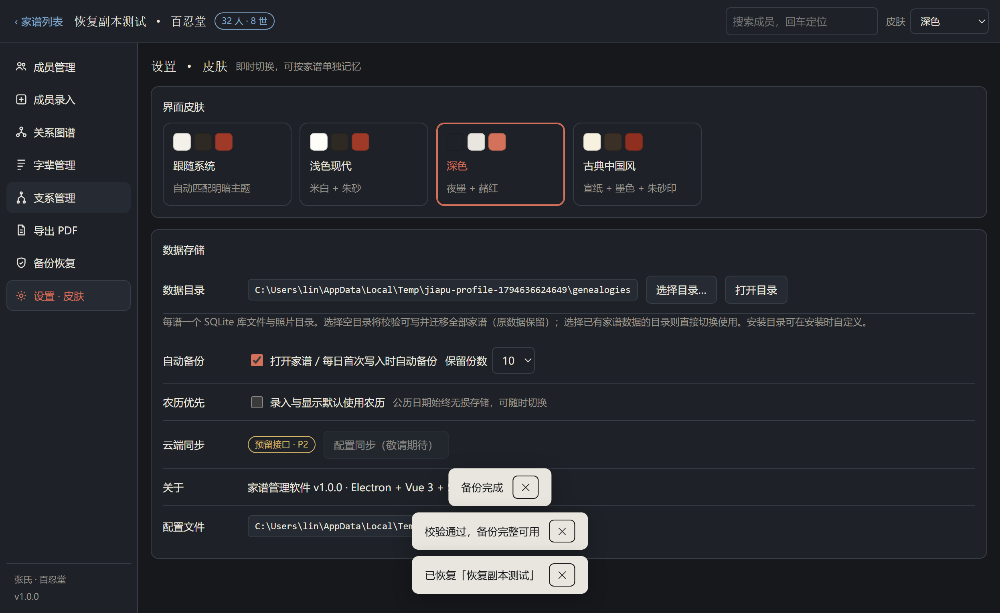

# 家谱管理软件（Jiapu）

> 数字化修谱与世系传承 —— 面向 Windows 桌面的开源家谱编修工具。

[](LICENSE)
[](../../releases/latest)
[](https://www.electronjs.org/)
[](https://vuejs.org/)

家谱管理软件是一款本地优先的桌面端修谱工具：以 SQLite 单文件存储世系数据，支持男女平等录入、过继 / 兼祧等特殊亲属关系、公历 / 农历双历日期，提供关系图谱与欧式、宝塔式、苏式三种传统谱书排版的一键 PDF 导出，面向约 2000 人规模的族谱编修场景。

## 功能特性

- **成员录入**：不限性别，女性可延续世系；姓名、字号、称谓、世代、支系、职业、居地、葬地、生平与照片；删除支持撤销。
- **特殊关系**：生父母 / 养父母 / 继父母、过继、兼祧（一子承多房，金色标记）、配偶（原配 / 继配等 subtype）。
- **农历日期**：公历 / 农历双历录入与展示，干支、生肖自动换算，字辈按世代自动推荐。
- **字辈管理**：字辈序列追加 / 删除末字，录入时按世代推荐用字。
- **支系管理**：房支创建、重命名、删除与成员统计。
- **关系图谱**：世系吊线可视化，缩放、适应、双击折叠 / 展开、搜索定位并联动详情。
- **PDF 导出**：欧式横表（五世横表）、宝塔式吊线图、苏式垂珠体三种排版；全谱或按支系导出；pdf-lib 矢量输出并内嵌中文子集字体，不依赖系统打印组件。
- **多家谱**：可创建多份家谱，同一时间仅打开一份，首页列表切换。
- **备份恢复**：ZIP 快照备份、完整性校验、恢复为新家谱副本，避免覆盖现谱。
- **皮肤切换**：浅色 / 深色 / 古典 / 跟随系统四套主题。
- **目录自定义**：安装目录与数据存储目录均可由用户选择，数据目录支持一键迁移。
- **本地优先**：全部数据存于本地，不上传任何信息；云端同步为预留接口。

## 界面预览

| 成员卡片列表（内联详情） | 关系图谱 |
| --- | --- |
|  |  |

| PDF 三排版预览 | 古典皮肤 |
| --- | --- |
|  |  |

| 深色皮肤 | 窄屏 / 移动端布局 |
| --- | --- |
|  |  |

## 快速开始

### 普通用户

从 [Releases](../../releases/latest) 下载 `jiapu-x.y.z-setup.exe` 双击安装（安装目录可自定义）。首次启动自动载入示例谱《张氏家谱 · 百忍堂》供体验，可在「家谱列表」中新建自己的家谱。

### 从源码运行

环境要求：Windows 10+、Node.js ≥ 22（推荐 24）。

```bash
npm install        # 仓库自带 .npmrc（npmmirror 镜像），可按需修改
npm run dev        # 启动 Electron 开发模式
```

### 构建与打包

```bash
npm run build      # 编译主进程 / 预加载 / 渲染端
npm run pack       # 免安装目录版
npm run dist       # NSIS 安装包（scripts/dist.mjs 已配置国内二进制镜像）
```

### 测试与类型检查

```bash
npm test           # node:test 单元测试（数据层、批量详情、备份恢复等）
npm run typecheck  # vue-tsc + tsc 双工程类型检查
```

## 技术栈

| 领域 | 选型 |
| --- | --- |
| 桌面框架 | Electron 45 |
| 界面 | Vue 3.5 + TypeScript 5.9 |
| 构建 | electron-vite 6 + Vite 8 |
| 存储 | node:sqlite（Node 内置 SQLite，单文件本地库） |
| PDF | pdf-lib + @pdf-lib/fontkit（矢量排版、内嵌 CJK 子集字体） |
| 农历 | lunar-typescript |
| 备份 | adm-zip（ZIP 快照 + 校验） |
| 打包 | electron-builder 26（NSIS） |

## 项目结构

```
├─ electron/
│  ├─ main/        # 主进程：SQLite 数据层、IPC、备份恢复、PDF 矢量导出、示例数据
│  ├─ preload/     # contextBridge 暴露的类型安全 API
│  └─ shared/      # 共享类型与农历换算
├─ src/
│  ├─ views/       # 成员管理 / 录入 / 图谱 / 字辈 / 支系 / 导出 / 备份 / 设置 / 首页
│  ├─ components/  # DateField（双历）、MemberPicker、Modal
│  ├─ graph/       # 世系图谱布局算法
│  ├─ print/       # 欧式 / 宝塔式 / 苏式排版构建
│  └─ styles.css   # 设计令牌与四套皮肤
├─ tests/          # node:test 单元测试
├─ scripts/        # 打包脚本
├─ docs/           # 需求文档与界面截图
└─ build/          # 应用图标
```

## 数据与隐私

- 数据默认存放于 `%APPDATA%/家谱管理软件`，可在「设置 · 皮肤」页自定义数据目录并一键迁移。
- 所有读写均发生在本地 SQLite 与本地备份目录，软件不发起任何数据上传。
- 备份为 ZIP 快照，恢复时默认创建新家谱副本，不破坏当前数据。

## 参与贡献

欢迎提交 Issue 与 Pull Request，请先阅读 [贡献指南](CONTRIBUTING.md)。

## 变更记录

见 [CHANGELOG.md](CHANGELOG.md)。

## 许可证

[MIT](LICENSE) © Lin